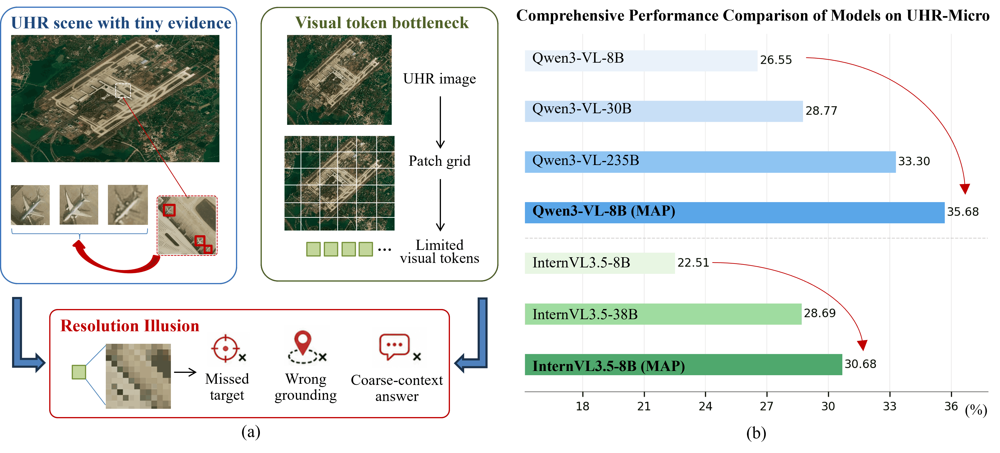
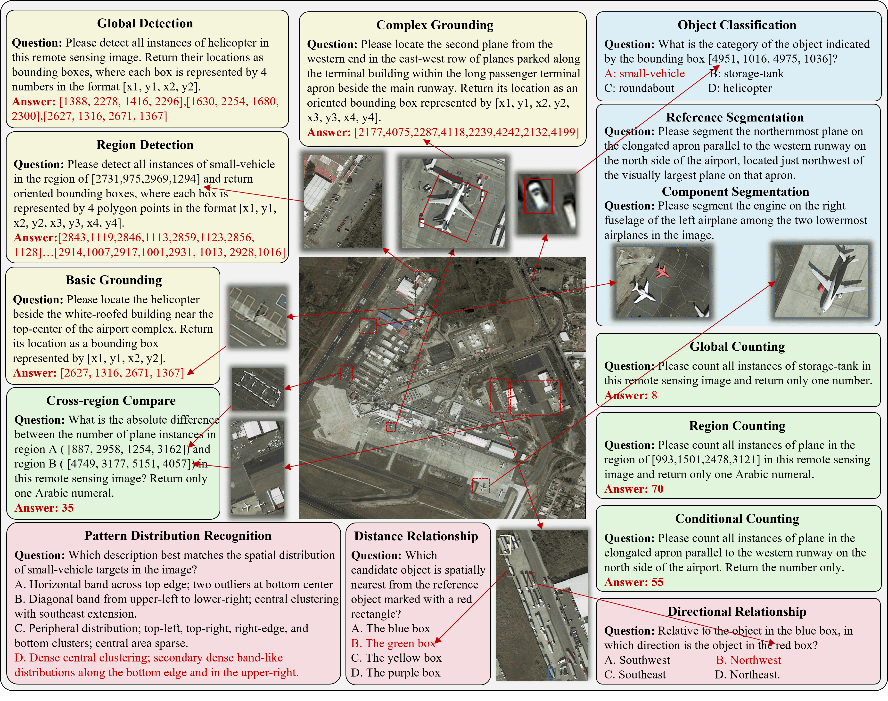
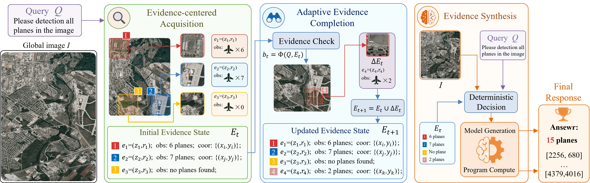

<div align="center">

<h1>UHR-Micro: Diagnosing and Mitigating the Resolution Illusion in Earth Observation VLMs</h1>

Shuo Ni<sup>1,3⋆</sup>,
Tong Wang<sup>1⋆</sup>,
Jing Zhang<sup>2,3†</sup>,
Di Wang<sup>2,3</sup>,
He Chen<sup>1</sup>,
Haonan Guo<sup>3,4</sup>,
Ning Zhang<sup>1,5†</sup>,
Bo Du<sup>2,3†</sup>.

<sup>1</sup> Beijing Institute of Technology,
<sup>2</sup> Wuhan University,
<sup>3</sup> Zhongguancun Academy,
<sup>4</sup> State Key Laboratory of LIESMARS, Wuhan University,
<sup>5</sup> Hong Kong Polytechnic University.

<sup>⋆</sup> Equal contribution, <sup>†</sup> Corresponding author

</div>

<p align="center">
  <a href="#-update">Update</a> |
  <a href="#-abstract">Abstract</a> |
  <a href="#-benchmark">Benchmark</a> |
  <a href="#-method">Method</a> |
  <a href="#-usage">Usage</a> |
  <a href="#-citation">Citation</a> |
  <a href="#-statement">Statement</a>
</p>

## 🔥 Update

- **[2026.10]** 📦 Benchmark dataset released on Hugging Face: [nishuo1999/UHR-Micro](https://huggingface.co/datasets/nishuo1999/UHR-Micro)
- **[2026.09]** 📄 Preprint under review. Source code released.

## 🌞 Abstract

Vision-Language Models (VLMs) face a severe scale mismatch between broad scene
context and micro-scale targets when analyzing ultra-high-resolution (UHR) Earth
observation imagery — a phenomenon we term the **resolution illusion**. To
benchmark this challenge, we introduce **UHR-Micro**, a benchmark of 11,072
instructions grounded in 1,212 UHR images spanning 16 tasks across grounding,
counting, spatial reasoning, and fine-grained understanding. We further propose
**Micro-evidence Active Perception (MAP)**, a training-free method that constructs a
spatially grounded evidence state from localized observations and supplements it
when the current evidence is insufficient. Across two backbones, MAP improves
UHR-Micro by 8.65 percentage points on average.

<div align="center">

</div>

<div align="center">
<b>Figure 1. Resolution illusion and MAP.</b>
</div>

## 📖 Benchmark

**UHR-Micro** evaluates whether VLMs can locate, interpret, and reason over
task-relevant micro-evidence in UHR remote-sensing imagery. Each instruction is
centered on an objectively verifiable target occupying less than 0.01% of the image
area, spanning 16 tasks across four families.

The full benchmark dataset (1,212 UHR images, 11,072 annotated instructions, 48.12GB) is publicly available on Hugging Face: [nishuo1999/UHR-Micro](https://huggingface.co/datasets/nishuo1999/UHR-Micro).

<div align="center">

</div>

<div align="center">
<b>Figure 2. Overview of UHR-Micro.</b>
</div>

## 🚀 Method

**MAP** acquires localized native-resolution observations, records each observation
with its source region, and composes a spatially grounded evidence state with the
global context. When the evidence is insufficient, MAP selectively acquires
additional observations to complete the state.

<div align="center">

</div>

<div align="center">
<b>Figure 3. Overview of MAP.</b>
</div>

## 🔨 Usage

### Environment

Three independent Python environments are required; see
[`ENVIRONMENT.md`](ENVIRONMENT.md) for the exact verified package versions.

### Inference

Direct inference (Qwen3-VL-8B):

```bash
python -m direct.cli run \
  --input-manifest /path/to/Test.jsonl \
  --run-config /path/to/run_config.json \
  --adapter-config direct/configs/qwen3_vl_8b.json \
  --model-path $MAP_MODEL_PATH \
  --image-root $MAP_DATASET/Datasource \
  --gpus 0,1,2,3
```

MAP (Qwen3-VL-8B, Validation):

```bash
MAP_RUN_DIR=/path/to/run \
MAP_DATASET=/path/to/UHR-Micro \
MAP_MANIFEST=/path/to/Validation.jsonl \
MAP_MODEL_PATH=/path/to/Qwen3-VL-8B-Instruct \
MAP_PHASE0=/path/to/phase0_contract.json \
MAP_EVALUATE=$(pwd)/evaluation/evaluate_formal.py \
python map/qwen3vl/run_validation.py
```

Test uses `map/qwen3vl/run_test.py`; InternVL3.5-8B uses
`map/internvl/run_validation.py` / `run_test.py`. All paths are supplied via
environment variables — see [`ENVIRONMENT.md`](ENVIRONMENT.md).

## ⭐ Citation

If you find UHR-Micro helpful, please give a ⭐ and cite:

```
@misc{ni2026uhrmicro,
      title={UHR-Micro: Diagnosing and Mitigating the Resolution Illusion in Earth Observation VLMs},
      author={Shuo Ni and Tong Wang and Jing Zhang and Di Wang and He Chen and Haonan Guo and Ning Zhang and Bo Du},
      year={2026},
      eprint={XXXX.XXXXX},
      archivePrefix={arXiv},
      primaryClass={cs.CV},
      note={Under review}
}
```

## 🎺 Statement

For any other questions please contact Shuo Ni at [shuoni@bit.edu.cn](mailto:shuoni@bit.edu.cn).

## 💖 Thanks

This project uses [SAM2](https://github.com/facebookresearch/sam2),
[Qwen3-VL](https://github.com/QwenLM/Qwen3-VL), and
[InternVL](https://github.com/OpenGVLab/InternVL). The benchmark is built on
FAIR1Mv2, DOTAv2, SODA-A, and xView. Thanks for their wonderful work!
